# Patients notice new uses for drugs years before scientists test them. I checked 501,000 reviews.

In 2016, someone taking the weight-loss shot Saxenda wrote in a review, "I have no desire to drink." Others said the same that year: "not feeling like drinking alcohol," "don't even want a glass."

Saxenda is a GLP-1 drug, the same family as Ozempic. The first human trial of a GLP-1 drug for drinking came out in 2022. The first one that worked, for Ozempic's ingredient, came out in 2025.

I read 501,000 drug reviews looking for side effects people were happy about, to see how often patients get there first.

## First, does this even work?

I picked 8 benefits where medicine already knows which drugs help: drinking less, smoking less, fewer migraines, clearer skin, weight loss, fewer hot flashes, less nerve pain and calmer legs at night. Before running anything, I wrote down the known drugs for each from treatment guidelines.

Then I ranked every drug by how often people said that benefit happened, counting only people who were taking the drug for something else.

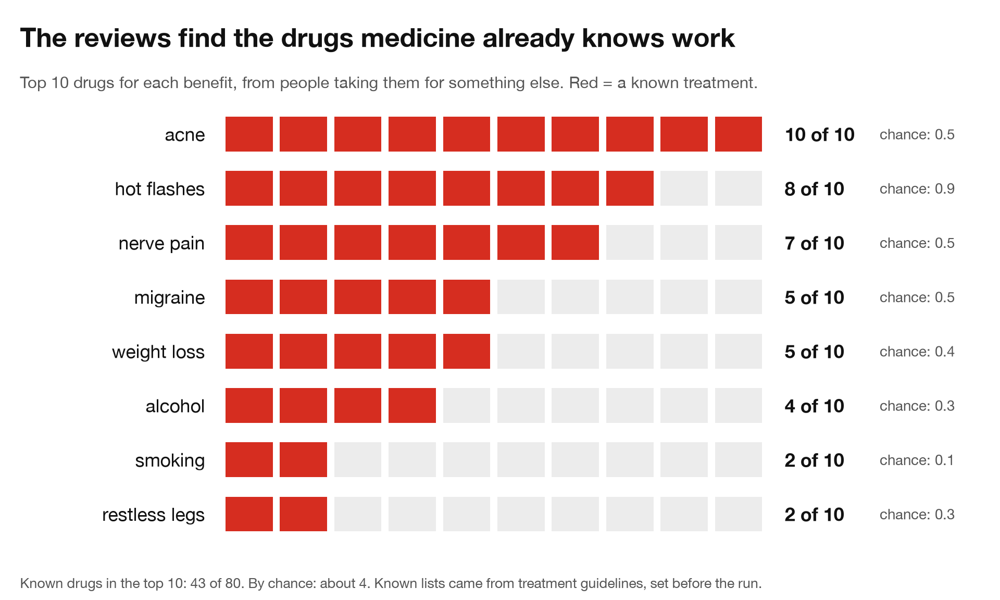

43 of the 80 top-10 spots went to known treatments. Chance would give about 4. When each drug was compared only against people with the same condition taking other drugs, it was still 37 of 80.

I picked those lists, so I ran it again with the FDA as the judge: a drug counted as known only if its FDA label lists that use. Across 18 benefits, from blood pressure to seizures to hay fever, labelled drugs took 53 of the 180 top-10 spots. Chance would give 4.

Some "misses" turned out to be real effects that weren't on my lists. Nortriptyline came first for migraine, and doctors use it to prevent them. Clonidine made the smoking list, and it helps people quit.

## Who stops wanting to drink without trying to

Here is the drinking list up close. It leaves out every review written for alcohol or addiction.

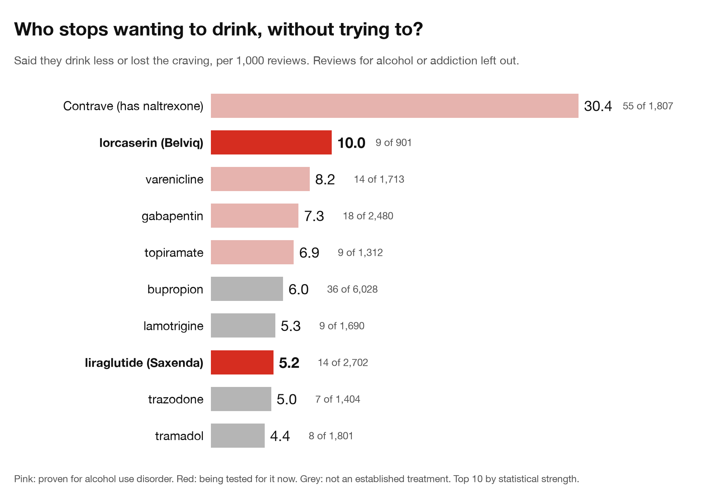

Four of the top seven are drugs proven to cut drinking: naltrexone (inside Contrave), varenicline, gabapentin and topiramate. These reviewers were taking them for weight, smoking, anxiety or migraines.

The other two are being tested for it right now. Among people taking weight-loss drugs, the GLP-1s ran at 8.8 reports per 1,000, against 1.2 for phentermine, Qsymia and orlistat. GLP-1 reviewers almost never mention losing other cravings, like cigarettes or coffee. Contrave and lorcaserin reviewers mention several.

Then lorcaserin (Belviq), a diet pill. Five reviewers in 2013 wrote things like "absolutely no craving for alcohol" and "don't crave wine at all." The first study of lorcaserin and alcohol, in rats, came out in October 2014. The first human study came out in 2021.

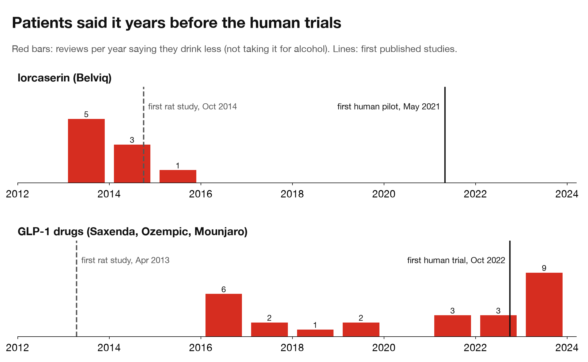

For the GLP-1s, rat studies came first, in 2013. The reviews still came about six years before the first human trial.

Could they have read about it first? I counted news stories on GLP-1 drugs and alcohol cravings. There were almost none until late 2022, then 161 in 2023. 16 of the 24 GLP-1 reviews saying they drank less came before that.

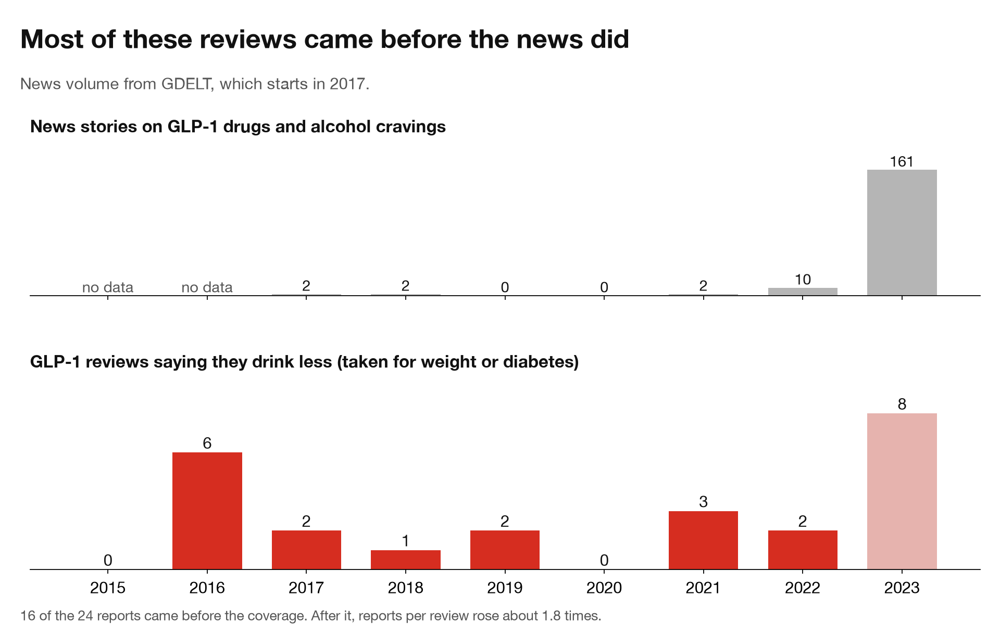

After the coverage, reports per review went up about 1.8 times, so some later reviewers were probably repeating what they read. Most of the reports came first, though.

## Going back in time

Two stories prove nothing, so I ran a backtest. I cut the reviews off at 2012, 2015 and 2018. At each cutoff I listed the benefits patients reported far more often than people on similar drugs did. Then I paired each one with drug and benefit combinations patients didn't single out, and searched PubMed for what came out after.

68% of the flagged benefits already had a paper before the cutoff, against 20% of the matched pairs, so patients do pick up real effects. For the test I kept only the ones science had barely touched: no paper on the benefit yet, and fewer than 10 papers that even mention the drug and the effect together.

19.5% of those got their first paper later (22 of 113). 4.5% of the matched pairs did (49 of 1,080). The median wait from the first review to the first paper was about 8 years.

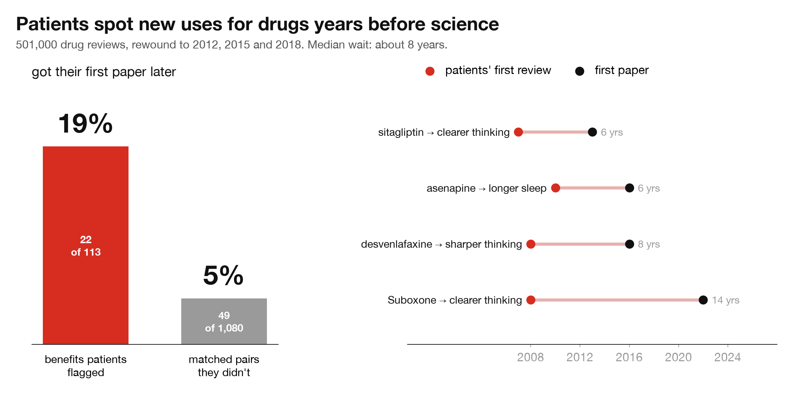

Human trials are a much higher bar. 6 of 99 flagged benefits got a registered trial later, against 1.9% of matched pairs. That points the same way, but six is too few to lean on.

The more people said it, the more often science followed. Benefits with 8 or more reports got a paper 26.5% of the time, against 12.5% for ones with only 3.

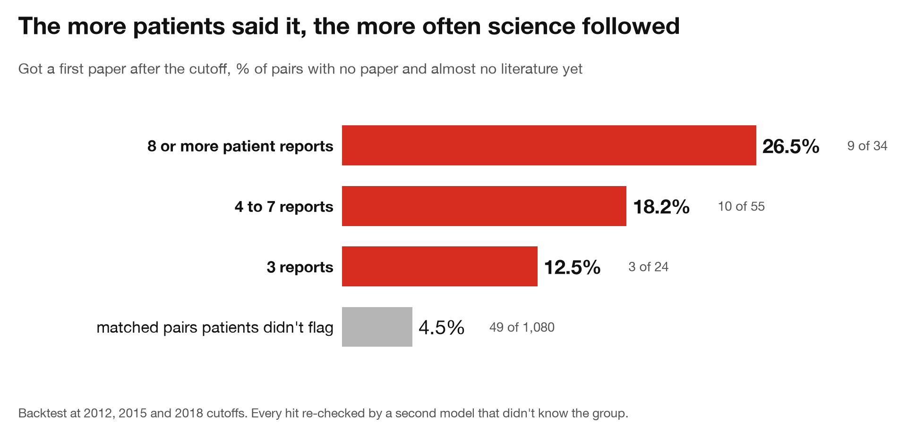

Across all pairs, matching on how often PubMed already mentioned the drug and the effect together, the flagged ones still had about 3.8 times the odds of a later paper (95% CI 2.5 to 5.8).

A few that patients called early:

- Sitagliptin, a diabetes pill. Three reviewers by 2012 wrote things like "my head/thinking is MUCH clearer." A 2013 study in diabetic rats found better memory.
- Desvenlafaxine (Pristiq), an antidepressant. Reviewers from 2008 on wrote things like "much more clear headed and focused." A placebo-controlled trial found better working memory in 2016.
- Suboxone, for opioid addiction. Reviewers from 2008 on wrote things like "much clearer thinking." A 2022 study tied six months on it to better cognitive scores.

A "paper" here can be a case report or an animal study, and a model judged which papers count. I re-checked every hit with a stricter second model that didn't know which group a pair came from, and the gap held. So this measures what scientists chose to look at later, not what works.

## Four that nobody has tested properly

Each one beats similar drugs, held up when I read the reviews by hand, and has no proper trial. Each also has a weak spot, which I've included.

### 1. Amlodipine and migraine

Amlodipine is a generic blood pressure pill that costs a few dollars a month. Among people taking it for blood pressure, 9 of 881 said their migraines went away. On blood pressure pills with no link to migraine it was 3 of 2,811.

That puts it next to verapamil and candesartan, two blood pressure drugs doctors already use to prevent migraine. Four people said the migraines came back when they stopped amlodipine, and two said they went away again when they restarted.

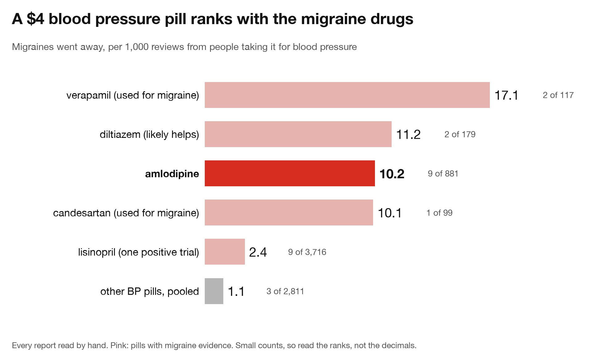

These are small numbers. Five of the nine were also on, or just off, other blood pressure drugs. Without them only four people remain, too few to call significant. The only trial gave 30 people a low dose mixed into a three-pill combo and found no clear effect. Nobody has tested amlodipine on its own.

### 2. Lorcaserin and sleep

The same diet pill from the drinking story. 48 of 1,008 people taking it for weight loss said they slept better, about 48 per 1,000. On every other weight-loss drug, Ozempic and Mounjaro included, it was 0 to 8 per 1,000.

About 21 of the 48 wrote it in their first two weeks, before much weight comes off. The GLP-1 drugs cause more weight loss and sit at 5 to 6 per 1,000.

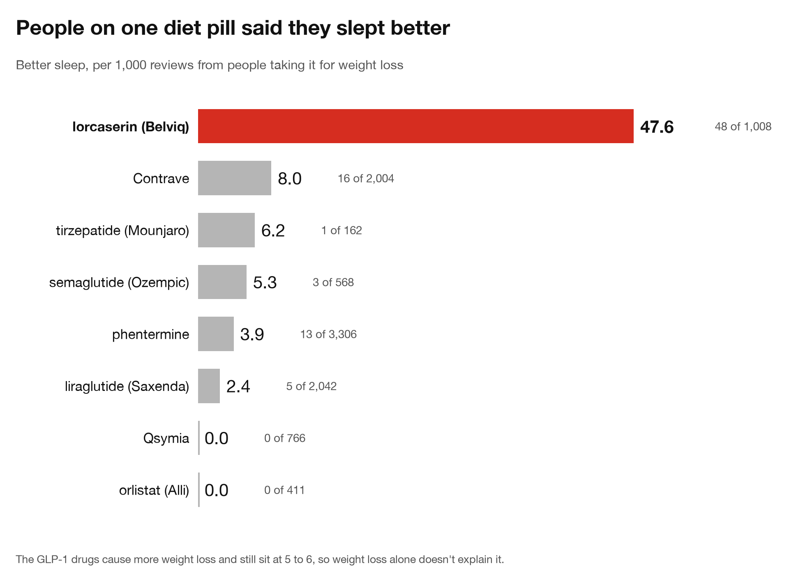

Some of it is launch hype. Several 2014 reviews read like ads, and the last 106 reviews (2018 to 2020) have none. Reviews from 2016 and 2017 alone still run at 26 per 1,000, about six times the other diet pills.

There's a catch. Drugs that switch on this receptor (5-HT2C) usually make sleep worse. In rats, one kept them awake longer and cut deep and dream sleep, and an older drug that hits it did the same to healthy volunteers. But in lorcaserin's own trials, twice as many people on the pill as on placebo reported fatigue, and about 1 in 5 reviewers who slept better also said it made them drowsy or tired. My guess is that they felt sleepier and rated their sleep better, and a sleep lab would show less dream sleep, not more.

Lorcaserin was pulled in 2020 over a possible cancer risk. Drugs aimed at the same receptor are in trials now for rare childhood epilepsies, where poor sleep is a big problem. A sleep measure in those trials would settle it cheaply.

### 3. Contrave and coffee

Contrave is two old drugs in one pill, bupropion and naltrexone. 10 of its 2,044 reviewers said the urge for coffee went away. One of them had a "30+ year addiction to coffee." On bupropion alone it was 1 of 4,107, and on naltrexone alone 0 of 834.

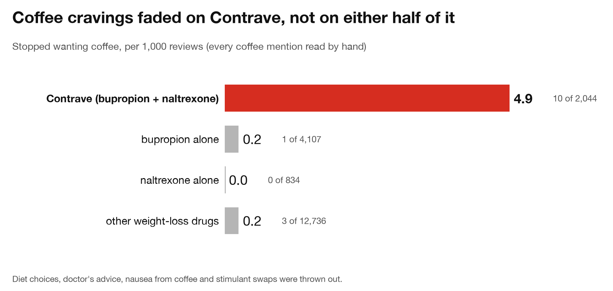

I read every coffee mention across 23 drugs and threw out diet choices, doctor's advice and coffee that made the nausea worse. Three of the ten had caffeine-withdrawal headaches, so they really were drinking less. Some tie it to cutting the cream and sugar, so part of this may be Contrave's known effect on sweet cravings. I found no paper on it.

### 4. The progestin-only pill and migraine

Migraines got better in 3.0% of reviews of progestin-only pills ("minipills") and 0.8% of reviews of combined pills. The implant, hormonal IUD and shot carry the same type of hormone and don't show it.

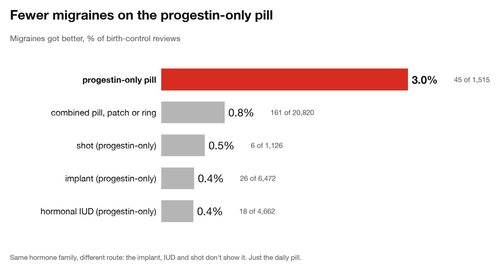

About half of these reviewers had just come off a pill, ring or patch with estrogen, which can trigger migraines by itself. With switchers removed from both sides the gap shrinks to about 2.7 times and holds. The minipills also turned up near the top of the migraine list in the known-answer test, which ranked every drug a different way.

The one minipill studied for migraine, desogestrel, isn't sold in the US. The US option that works the same way, Slynd, has no migraine data. Its reviews show the pattern, but only 10 people report it.

## How the rest died

The last scan over every drug started with 2,169 candidates and ended with one strong new lead.

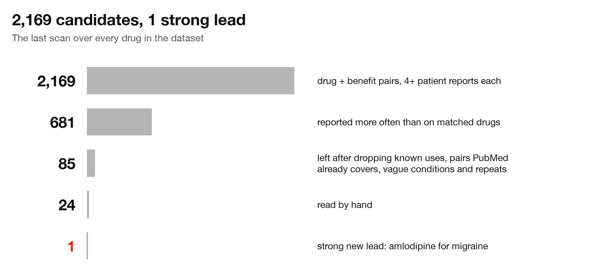

Most leads die once you read the reviews. Four ways it happened:

- The whole drug class does it. Nebivolol reviewers said it calmed them down, but beta blockers in general do that, and it has been studied since 1985.
- It was the reason they took it. All 11 people who said niacin fixed their anxiety were taking it for depression.
- They had just quit the drug that caused the problem. Lumateperone reviewers who lost weight had just come off the drug that made them gain it.
- Some drugs' fans praise everything. Mounjaro reviewers list 0.84 extra benefits per review and Ozempic reviewers 0.46. Without a correction for that, everything about Mounjaro looks like a discovery.

## Limits

None of this is medical advice. A review is a hint, and every number above comes from what people chose to write online. Some reviewers may have heard about an effect from their doctor or the news before they wrote about it.

Still, the reviews found the known drugs ten times more often than chance. Benefits they flagged got studied about four times as often as matched pairs, around 8 years later. And the four above have no proper trial yet.

To keep myself honest, I froze today's list on GitHub: 835 benefits patients are flagging now and 1,638 matched pairs, with the scoring rules and a hash so none of it can change. In 2031 I'll check which ones got studied and post the hits and the misses. The list and the scoring rules are in [PREDICTIONS.md](../PREDICTIONS.md), and my odds for each lead are in [PREDICTIONS_2026-10-28.md](../PREDICTIONS_2026-10-28.md).

If you run trials in migraine, sleep or addiction and want the review data behind any of these, my DMs are open ([@BitsByNick](https://x.com/BitsByNick) on X).

*Method: 501k reviews from Drugs.com, WebMD and Erowid. Drug names were masked before a model pulled out the benefits, so it couldn't lean on what it already knew, and every report was checked a second time. Each lead was compared against similar drugs taken for the same condition. Known-answer lists came from treatment guidelines and were fixed before the run. Backtest papers were judged from PubMed abstracts by one model, and every hit was re-checked by a stricter second model that didn't know which group it came from.*
